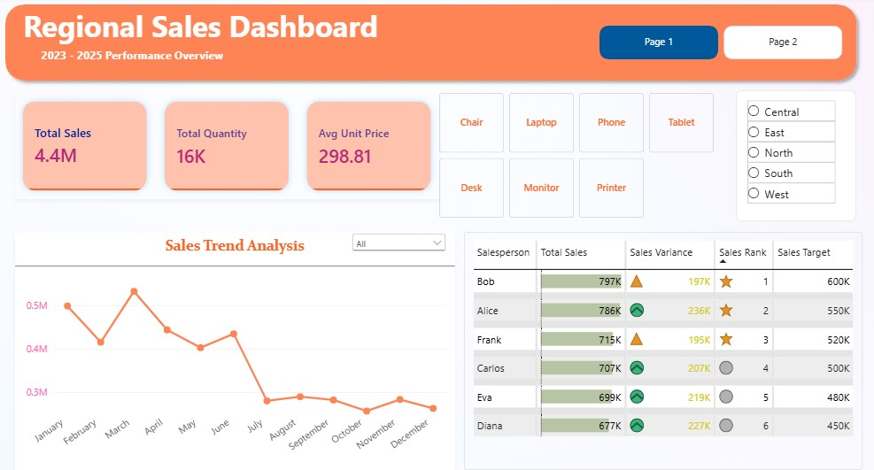
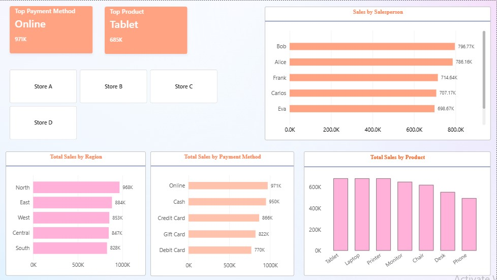

 📊 Regional Sales Dashboard

An interactive Power BI dashboard analyzing regional sales performance across 2023–2025, covering **$4.4M in total sales** across 5 regions, 7 products, and 6 salespeople.

 🎯 Business Problem
The sales team needed a clear, data-driven view of regional performance to identify top performers, track sales targets, and understand product and payment preferences across the 2023–2025 period.

 🛠️ Tools Used
- **Power BI** — interactive dashboard & visualizations
- **Power Query** — data cleaning & transformation
- **DAX** — calculated measures (Total Sales, Variance, Rank, YoY growth)

 📸 Dashboard Preview

 Page 1 — Sales Overview

Page 2 — Detailed Breakdown

 📈 Key Metrics
- **Total Sales:** 4.4M
- **Total Quantity:** 16K
- **Avg Unit Price:** 298.81
- **Period:** 2023–2025

## 💡 Key Insights

**Regional Performance**
- North region leads with 968K in sales, followed by East (884K)
- South is the lowest at 828K — opportunity for growth

**Salesperson Performance**
- Bob is #1 with 797K sales (197K above target)
- Alice is #2 with 786K (236K above target — highest variance)
- Every salesperson exceeded their target

**Product Insights**
- Tablet is the top product (685K), followed by Laptop and Printer
- Phone is the lowest at ~480K

**Payment Insights**
- Online is the top payment method (971K)
- Debit Card is lowest (770K)

**Sales Trend**
- Sales peak in March and Q4 (Nov–Dec)
- Sharp decline in July — seasonal dip

## 🎛️ Interactive Features
- Region filter (North, East, South, West, Central)
- Product category filter (Chair, Laptop, Phone, Tablet, Desk, Monitor, Printer)
- Multi-page navigation (Page 1 / Page 2)
- Salesperson target vs. actual tracking

 📫 Contact
- [LinkedIn](https://www.linkedin.com/in/arisha-ahmer)
- [Email](mailto:humaraahmer55@gmail.com)
